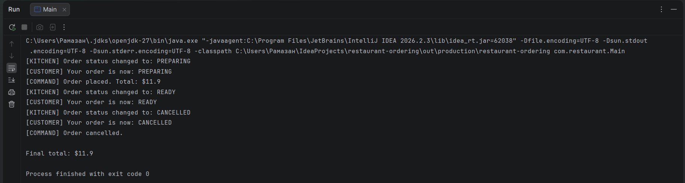

# 🍔 Restaurant Ordering System

## 📌 Project Overview
This project is a Java-based application developed as a final project defense for the Design Patterns course. It simulates a restaurant ordering system where customers can customize meals, apply discounts, and receive real-time status updates.

The core objective of this project is to demonstrate the integration of **six distinct design patterns** into a single, cohesive, and operational framework.

---

## 🏗️ Architecture & Design Patterns

The system is built using the following six design patterns, divided into three categories:

### 1. Creational Patterns
*   **Factory Method (`factory` package):** Used to create different types of menu items (Pizzas, Burgers, Drinks) without exposing the instantiation logic to the client. It allows the system to easily introduce new item types in the future.
*   **Builder (`builder` package):** Used to construct complex meal combos (e.g., Main Course + Drink + Dessert) step-by-step. It separates the construction of a complex object from its representation, providing a fluent API (`MealComboBuilder`).

### 2. Structural Patterns
*   **Decorator (`decorator` package):** Used to add extra toppings (Cheese, Bacon, Mushrooms) to menu items dynamically at runtime. It allows adding behavior/responsibilities to individual objects without affecting other objects of the same class.

### 3. Behavioral Patterns
*   **Strategy (`strategy` package):** Defines a family of algorithms (Discount strategies: `NoDiscount`, `StudentDiscount`, `HappyHourDiscount`), encapsulates each one, and makes them interchangeable. The `Order` class delegates the total price calculation to the active strategy.
*   **Observer (`observer` package):** Defines a one-to-many dependency between objects. When the `Order` status changes (e.g., PREPARING, READY, CANCELLED), all subscribed observers (`KitchenDisplay`, `CustomerNotifier`) are automatically notified and updated.
*   **Command (`command` package):** Encapsulates a request as an object. Actions like `PlaceOrderCommand` and `CancelOrderCommand` are wrapped in objects, allowing the `OrderInvoker` to execute them. This makes the system easily extendable for logging or undo functionality.

---

## 📂 Project Structure

```text
src/main/java/com/restaurant/
├── Main.java                 # Application entry point (demonstrates pattern integration)
├── model/                    # Core domain entities (Order, MenuItem, OrderStatus)
├── factory/                  # [Pattern 1] Factory Method
├── decorator/                # [Pattern 2] Decorator
├── builder/                  # [Pattern 3] Builder
├── strategy/                 # [Pattern 4] Strategy
├── observer/                 # [Pattern 5] Observer
└── command/                  # [Pattern 6] Command
```

---

## 🚀 How to Run

1. Clone the repository to your local machine.
2. Open the project in **IntelliJ IDEA** (or any Java IDE).
3. Ensure that the `src/main/java` directory is marked as a **Sources Root** (Right-click -> Mark Directory as -> Sources Root).
4. Locate the `Main.java` file inside the `com.restaurant` package.
5. Run the `main` method.

### Expected Console Output

When executed, the program demonstrates the entire lifecycle of an order, combining all patterns:



## 📚 Technologies Used
*   **Java** (JDK 17+ recommended)
*   **Object-Oriented Programming (OOP)**
*   **SOLID Principles** (especially Open/Closed and Single Responsibility)

---

## 📝 Further Work
*   Integrate a database (e.g., PostgreSQL) using the **DAO (Data Access Object)** pattern.
*   Add a graphical user interface (GUI) using JavaFX or Swing.
*   Implement the **State pattern** to manage the strict transitions between order statuses.
*   Write unit tests using JUnit to validate discount strategies and order total calculations.


